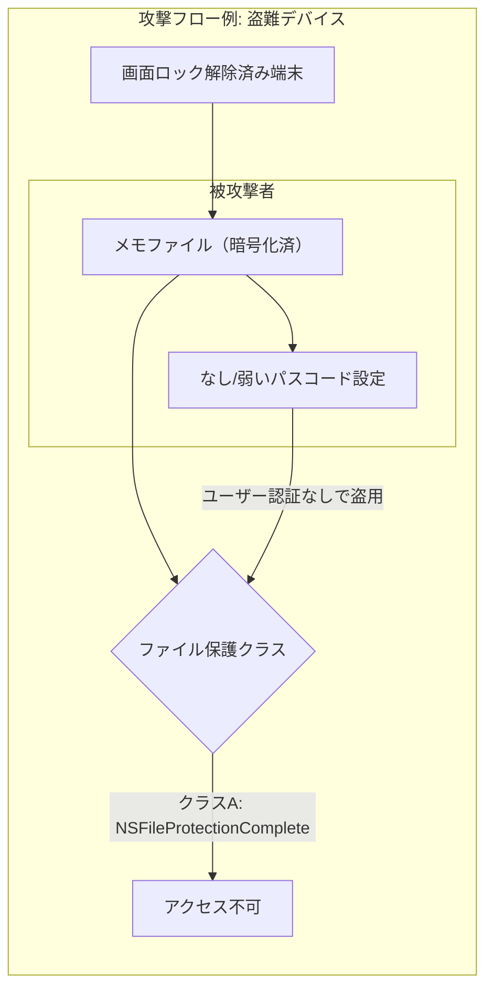

# iOSメモアプリのデータ保護と外部API利用におけるセキュリティ

## エグゼクティブサマリー

本報告書では、ユーザーデータを端末内にのみ保存し、任意で外部AI APIを呼び出すiOSメモアプリに対し、**ローカルおよびネットワーク経由でのデータ流出防止**を中心に検討する。**脅威モデル**としては、端末の盗難やマルウェア攻撃、ネットワーク盗聴（MITM）、外部APIプロバイダの侵害、サプライチェーン攻撃、OS/Jailbreak脆弱性などを想定する。各シナリオについて、攻撃手法と影響度を評価し、**具体的な防御策**を提示する。防御策には、iOS標準の**データ保護クラス**や**キーチェーン／Secure Enclave**の活用、**サンドボックス**設定、**ATS/TLSピンニング**などのネットワークセキュリティ、データ最小化・匿名化、オフラインファースト設計などが含まれる。さらに、**Swiftによる実装例**（ファイル暗号化、キーチェーン操作、Secure Enclave鍵生成、TLSピンニングなど）を示し、**推奨設定（Entitlements, Info.plist, ビルド設定）やライブラリ検証手順**をまとめる。最後に、**テスト手順やツール**（ユニットテスト、ペネトレーションテスト、ファジング、ネットワーク検査、CIチェックス）と**テスト結果サンプル**を提供し、**対策の優先度付きチェックリスト**や**比較表**（オンデバイス vs リモート処理、暗号化手法の比較など）も掲載する。全体を通じて、公式AppleドキュメントやOWASP指針など信頼性の高い情報源に基づいて解説する。

## 脅威モデルと攻撃シナリオ

- **ローカルデバイス侵害:** 端末の盗難・紛失、または不正侵入（例：マルウェア、OS脆弱性の悪用）により端末内のデータに直接アクセスされるリスク。影響度は高く、ユーザー認証解除前のデータ保護が重要となる。  
- **悪意あるアプリ（マルウェア）:** App Storeや企業配布アプリに紛れ込んだ悪意アプリが、アプリ同士の共有フォルダや未保護のファイルを読み取る試み。通常、iOSのサンドボックスにより他アプリからのアクセスは制限されるが、不適切な共有設定やURLスキームによるデータ公開に注意が必要。  
- **ネットワーク盗聴・MITM攻撃:** Wi-Fiやキャリアネットワーク上での通信傍受。外部AI APIとの通信時に平文通信や脆弱なTLS設定があると、メモ内容が傍受される恐れ。影響度は中〜高。ATS/TLSピンニングなどで対策。  
- **外部APIプロバイダの侵害:** 呼び出すAIサービス提供者側が侵害された場合、送信データが漏洩するリスク。外部送信そのものを極力抑え、最小限のデータのみ送信するか、可能であればオンデバイス処理することが対策となる。  
- **サプライチェーン攻撃／ライブラリ脆弱性:** アプリに組み込む外部ライブラリ・SDKの脆弱性や仕込みコードによるデータ流出。依存ライブラリの安全性検証（公式出所、定期的な脆弱性スキャン、署名検証など）や使用範囲の最小化が重要。  
- **OS脆弱性／Jailbreak:** iOSのゼロデイ脆弱性や脱獄状態では、サンドボックスが破られ攻撃者が広範な権限を得る可能性がある。一般ユーザーの脱獄は想定外の環境とみなし、**強固なデータ保護クラスの利用**や**生体認証／パスコードによるロック**でリスク緩和を図る。  
- **物理アクセス:** 認証済みまたは画面ロック解除状態の端末を物理的に取得された場合、データ閲覧リスクが生じる。デフォルトでデータは暗号化されているが、**自動ロック設定の厳格化**や**必要に応じた自動ワイプ（MDM等）**で補強する。

## 対策方針と具体的防御策

- **データ保護クラスの活用:** ファイルやデータベースに対し、可能な限り強いデータ保護クラス（`NSFileProtectionComplete`クラスA）を設定する。AppleのPlatform Securityガイドでは、ファイル作成時にデータ保護クラスが割り当てられ、「NSFileProtectionComplete」は**デバイスロック時に暗号鍵が破棄され、再認証までデータアクセス不可**とする最も強力な設定とされる。アプリのデフォルト設定も`CompleteUntilFirstUserAuthentication`（クラスC、再起動後最初のロック解除まで鍵保持）から`Complete`に変更し、ユーザーデータを最大限保護する。具体的には、以下のようにファイルを保存する際に`.completeFileProtection`オプションを指定する：
  
  ```swift
  // 強力なファイル保護クラス（Complete）でデータを書き込む例
  let data: Data = ... // メモ内容など
  let fileURL: URL = ... // 保存先パス
  try data.write(to: fileURL, options: .completeFileProtection)
  ```
  
  ディレクトリ作成時も保護キーを指定できる（iOS17以降は新規ファイルも継承）：
  
  ```swift
  // ディレクトリ作成時にファイル保護属性を設定
  try FileManager.default.createDirectory(
      at: directoryURL,
      withIntermediateDirectories: true,
      attributes: [.protectionKey: FileProtectionType.complete]
  )
  ```
  
  これにより、デバイスロック状態では該当ファイルへアクセスできなくなる（自動ロックのタイミングは設定で最短10秒）。**機密度の低いファイル以外は必ずComplete保護**とし、`NSFileProtectionNone`（保護なし）は絶対に使わない。また、バックグラウンド処理で書き込みが必要な場合は`CompleteUnlessOpen`も検討する。なお、キーリストや共有コンテナの場合も同様に保護属性を設定するべきである。

- **キーチェーン／Secure Enclaveの利用:** パスワードや暗号鍵など機密情報はキーチェーンで保護する。Appleのドキュメントによれば、キーチェーン項目もファイル同様のクラス構造で保護され、`kSecAttrAccessibleWhenUnlocked`（アンロック時のみ）や`kSecAttrAccessibleAfterFirstUnlock`（再起動後最初のアンロック後から常時）などがある。ユーザーのパスコードで保護された機種では、`kSecAttrAccessibleWhenPasscodeSetThisDeviceOnly`などのオプションも利用でき、この場合バックアップ・同期から除外される。**パスワードや暗号鍵は最も制限された保護レベル（例：デバイス解除時のみ）で保存**することで安全性を高める。以下はキーチェーンに文字列を保存する例で、`ThisDeviceOnly`属性も併用して機密度を上げている：

  ```swift
  let secret = "機密データ"
  guard let secretData = secret.data(using: .utf8) else { return }
  let addQuery: [String: Any] = [
      kSecClass as String: kSecClassGenericPassword,
      kSecAttrAccount as String: "memoServiceToken",
      kSecValueData as String: secretData,
      kSecAttrAccessible as String: kSecAttrAccessibleWhenUnlockedThisDeviceOnly
  ]
  SecItemAdd(addQuery as CFDictionary, nil)
  ```

  また、**Secure Enclave**内で鍵を生成・保持し、暗号処理に利用する方法もある。Secure EnclaveはAppleデバイスの専用セキュアサブシステムで、「カーネルが破られても機密データを保護する設計」が特徴だ。キーチェーン項目の暗号化鍵テーブルキーはSecure Enclaveで保護される。Secure Enclaveを使って、アプリ固有の鍵ペアを生成する例を以下に示す：

  ```swift
  // Secure Enclave上で楕円曲線鍵ペアを生成し、Touch ID/Face ID認証を要求
  let access = SecAccessControlCreateWithFlags(nil,
      kSecAttrAccessibleWhenUnlockedThisDeviceOnly,
      .userPresence,
      nil
  )!
  let attributes: [String: Any] = [
      kSecAttrKeyType as String: kSecAttrKeyTypeECSECPrimeRandom,
      kSecAttrKeySizeInBits as String: 256,
      kSecAttrTokenID as String: kSecAttrTokenIDSecureEnclave,
      kSecPrivateKeyAttrs as String: [
          kSecAttrIsPermanent as String: true,
          kSecAttrApplicationTag as String: "com.example.memo.privatekey",
          kSecAttrAccessControl as String: access
      ]
  ]
  var error: Unmanaged<CFError>?
  guard let privateKey = SecKeyCreateRandomKey(attributes as CFDictionary, &error) else {
      // エラー処理
      return
  }
  let publicKey = SecKeyCopyPublicKey(privateKey)
  ```
  
  これにより、秘密鍵はSecure Enclave内に生まれ、端末外に出ることはない。公開鍵はサーバ送信用に取り出せる。ユーザー認証（生体認証・パスコード）でのみ鍵操作が可能となり、強固なキー管理が実現する。

- **アプリサンドボックスとNSFileCoordinator:** iOSは各アプリをサンドボックス化し、他アプリからデータアクセスを厳格に制限する。自アプリ内データは他アプリから参照不可だが、**App Groups**や不適切な共有設定は避けるべきだ。ファイルアクセス時は`NSFileCoordinator`や`NSFilePresenter`を用いて、他プロセスとの競合を安全に処理する。これにより、バックグラウンド更新などでファイルを開放中に他処理が干渉しないように調整できる。

- **ネットワークセキュリティ（ATS/TLSピンニング）:** 外部APIとの通信では**HTTPS（TLS 1.2+）**を必須とする。App Transport Security (ATS) により、デフォルトでTLS/1.2以上で暗号化されていないHTTP通信はブロックされる。Info.plistの`NSAppTransportSecurity`でATSを有効化し、例外は極力不要とする。さらに、通信先APIの証明書をホワイトリスト化するTLSピンニングを実装し、中間者攻撃（MITM）を防ぐ。たとえば、`URLSession`の`didReceive challenge`デリゲートでサーバ証明書を検証し、アプリ内に埋め込んだ公開鍵や証明書と突合する。例：

  ```swift
  func urlSession(_ session: URLSession,
                  didReceive challenge: URLAuthenticationChallenge,
                  completionHandler: @escaping (URLSession.AuthChallengeDisposition, URLCredential?) -> Void) {
      guard let serverTrust = challenge.protectionSpace.serverTrust else {
          completionHandler(.cancelAuthenticationChallenge, nil)
          return
      }
      // ピンニング用の証明書データをロード
      let localCertURL = Bundle.main.url(forResource: "api_cert", withExtension: "der")!
      let localCertData = try! Data(contentsOf: localCertURL)
      let localCert = SecCertificateCreateWithData(nil, localCertData as CFData)!
      
      // サーバ証明書の検証
      if let serverCert = SecTrustGetCertificateAtIndex(serverTrust, 0),
         serverCert == localCert {
          completionHandler(.useCredential, URLCredential(trust: serverTrust))
      } else {
          completionHandler(.cancelAuthenticationChallenge, nil)
      }
  }
  ```

  これにより、たとえ端末に不正なプロキシ証明書がインストールされていても、期待するサーバ証明書以外の接続は拒否される。プロキシ検出としては、`CFNetworkCopySystemProxySettings`などでシステムプロキシの存在を確認したり、Wi-Fi設定プロファイルの有無をチェックすることも考えられる。

- **データ最小化・匿名化:** 外部APIに送信する際は送信データを最小限にとどめ、個人を特定可能な情報は可能な限り除去する。例：メモ文章から氏名・住所・電話番号などを正規表現でフィルタリングする、不要なメタデータは付与しない。差分プライバシー（Differential Privacy）技術はユーザー集合データの統計集計向けであり、個別のユーザー発信には直接適用しづらいが、分析用ログ集計などではAppleが導入している例がある。オフライン処理可能な自然言語解析は端末上で行い、AI翻訳などのサービス呼び出しも**可能な限りモデルをオンデバイスで動かす**。どうしても外部送信が必要な場合は、**エンドツーエンド暗号化**を検討するが、AIが内容を解析するには平文が必要なため、現実的にはAPIが要求する範囲を超えないよう留意する。

- **オフラインファースト設計:** アプリはネットワーク未接続でも機能する設計とし、ネットワークアクセスを前提にしない。これにより、ネットワーク攻撃機会を減らすとともに、ネットワーク障害時のデータ可用性を確保する。外部APIへの問い合わせ結果は**キャッシュ**する際も暗号化して保存し、キャッシュポイズニングを防ぐ。常にユーザーデータは端末内で暗号化し、送信が済んだらメモリから速やかにクリアする。ログについてはエラー情報等のみ最小限に留め、ユーザー内容を直接記録しない（コンソールログやクラッシュログにメモ内容が残らないよう注意）。

- **同意プロンプトとプライバシー説明:** 外部API送信機能はユーザー同意を得て実行する。データ送信前に「メモ内容を外部サーバへ送信します」といったダイアログで説明・同意を取り、プライバシーポリシーや利用規約に明示する。必要なら送信ログにも同意フラグを付けて記録する。

## 実装ガイド：コード例

- **ファイル暗号化（データ保護クラス）:** 先述の通り、`Data.write(to:options:)`で`.completeFileProtection`を指定する。読み込み時も通常の`Data(contentsOf:)`で暗号解除される。例（書き込み）:

  ```swift
  let noteData = "ユーザーメモ".data(using: .utf8)!
  let url = FileManager.default.urls(for: .documentDirectory, in: .userDomainMask)[0]
      .appendingPathComponent("memo.txt")
  try noteData.write(to: url, options: .completeFileProtection)
  ```

- **キーチェーン操作:** 新規データの追加、取得、削除の例を示す。Accessibility属性に`WhenUnlockedThisDeviceOnly`を用いてセキュリティを強化する：

  ```swift
  // 保存
  let token = "ユーザー秘密トークン".data(using: .utf8)!
  let addQuery: [String: Any] = [
      kSecClass as String: kSecClassGenericPassword,
      kSecAttrService as String: "MemoAppService",
      kSecAttrAccount as String: "userAuthToken",
      kSecValueData as String: token,
      kSecAttrAccessible as String: kSecAttrAccessibleWhenUnlockedThisDeviceOnly
  ]
  SecItemAdd(addQuery as CFDictionary, nil)

  // 取得
  let query: [String: Any] = [
      kSecClass as String: kSecClassGenericPassword,
      kSecAttrService as String: "MemoAppService",
      kSecAttrAccount as String: "userAuthToken",
      kSecReturnData as String: true
  ]
  var item: CFTypeRef?
  let status = SecItemCopyMatching(query as CFDictionary, &item)
  if status == errSecSuccess, let data = item as? Data,
     let tokenString = String(data: data, encoding: .utf8) {
      // トークン取得成功
      print(tokenString)
  }

  // 削除
  let deleteQuery: [String: Any] = [
      kSecClass as String: kSecClassGenericPassword,
      kSecAttrService as String: "MemoAppService",
      kSecAttrAccount as String: "userAuthToken"
  ]
  SecItemDelete(deleteQuery as CFDictionary)
  ```

- **Secure Enclave鍵生成:** 前節で示した通り、`SecKeyCreateRandomKey`で楕円曲線鍵ペアを生成する。以下はポイントのみ抜粋：

  ```swift
  let accessControl = SecAccessControlCreateWithFlags(nil, kSecAttrAccessibleWhenUnlockedThisDeviceOnly, .userPresence, nil)!
  let privateKeyParams: [String: Any] = [
      kSecAttrIsPermanent as String: true,
      kSecAttrApplicationTag as String: "com.example.memo.private",
      kSecAttrAccessControl as String: accessControl
  ]
  let keyPairParams: [String: Any] = [
      kSecAttrKeyType as String: kSecAttrKeyTypeECSECPrimeRandom,
      kSecAttrKeySizeInBits as String: 256,
      kSecAttrTokenID as String: kSecAttrTokenIDSecureEnclave,
      kSecPrivateKeyAttrs as String: privateKeyParams
  ]
  var error: Unmanaged<CFError>?
  guard let privateKey = SecKeyCreateRandomKey(keyPairParams as CFDictionary, &error) else {
      fatalError("鍵生成エラー: \(error!.takeRetainedValue())")
  }
  let publicKey = SecKeyCopyPublicKey(privateKey)
  ```

  生体認証（Touch ID/Face ID）やデバイス解除時にのみキー操作できるよう`kSecAccessControlFlags.userPresence`を設定している。

- **TLSピンニング／URLSession設定:** 独自の`URLSession`と`URLSessionDelegate`を用いて、サーバ証明書を検証する。上述した`didReceive challenge`デリゲートで、予め組み込んだサーバ証明書（または公開鍵）と照合するコード例を参照。`URLSession`の設定例：

  ```swift
  let config = URLSessionConfiguration.ephemeral
  config.timeoutIntervalForRequest = 30
  let session = URLSession(configuration: config, delegate: self, delegateQueue: nil)
  let request = URLRequest(url: URL(string: "https://api.example.com/ai")!)
  let task = session.dataTask(with: request) { data, response, error in
      // レスポンス処理
  }
  task.resume()
  ```

  この設定では、ATSに準拠した通信が強制され、`delegate`でピンニングを実装する。

- **リクエスト/レスポンスのレダクション:** ログ出力時に機密データが残らないよう注意する。例えば、`print(request)`や`print(response)`をデバッグで使用すると、URLやヘッダに含まれるトークンが出力される可能性がある。**調査用プロキシ検査**時に備え、`URLSession`のTaskを中継するカスタム`URLProtocol`を実装して通信内容を検査する方法もある。ユーザーが送信前に内容を確認・編集できるUIを用意しておくと安全性が高まる。

- **同意プロンプト（Swift例）:** 外部送信の前に同意を取得するUIの例を示す：

  ```swift
  import UIKit

  func promptForAPIAccess(from viewController: UIViewController, completion: @escaping (Bool) -> Void) {
      let alert = UIAlertController(
          title: "外部API利用の確認",
          message: "メモの内容を外部サーバーに送信します。送信前に個人情報が含まれていないことを確認してください。同意しますか？",
          preferredStyle: .alert
      )
      alert.addAction(UIAlertAction(title: "キャンセル", style: .cancel) { _ in
          completion(false)
      })
      alert.addAction(UIAlertAction(title: "同意", style: .default) { _ in
          completion(true)
      })
      viewController.present(alert, animated: true, completion: nil)
  }
  ```

  ユーザーが「同意」を選んだ場合にのみネットワークリクエストを実行し、同意の有無をログに残しておく。

## 推奨設定および検証項目

- **Entitlements（権限設定）:**  
  - `com.apple.developer.default-data-protection`: アプリのデフォルトファイル保護クラスを指定可能。`CompleteUnlessOpen`または`Complete`を設定し、可能なら`Complete`にする。  
  - App Sandbox: iOSでは常に有効。特にファイル共有やインターアプリ通信用のエントitlements（アプリグループなど）は不要なら設定しない。  
  - Networkセキュリティ関連: 特別な権限不要だが、App Transport Security設定はInfo.plistで行う。

- **Info.plist設定:**  
  - **App Transport Security:** デフォルトでATS有効。`NSAllowsArbitraryLoads`は`false`とし、例外設定は可能な限り避ける（必要最低限のホストだけ例外を許可）。  
  - **ATS Strict Enforcement:** HTTPS (TLS 1.2+) のみ許可、暗号スイートや認証局も最新を利用する。  
  - **プライバシー関連:** 位置情報やカメラなど不要なプライバシー権限は削除する。  
  - **Background Modes:** バックグラウンド処理が不要ならOFF。必要なら`background-fetch`や`remote-notification`程度に留める。

- **ビルド設定:**  
  - リリースビルドでは最適化オプション（`-O`)を有効化し、デバッグログを除去する。  
  - **Strip Linked Product**および`DWARF with dSYM`設定により、シンボル情報の取り扱いを適切にする。  
  - **Bitcode:** Apple関連サービスを使わない場合は不要。  
  - **Swiftコンパイラフラグ:** `-D RELEASE` などで実機ビルドとデバッグビルドを分け、条件コンパイルすることも可能。

- **サードパーティライブラリ検証チェックリスト:**  
  1. ライブラリの出典が公式または信頼できるベンダーか確認（GitHub公式リポジトリやCocoaPodsなど）。  
  2. ライブラリのライセンスや脆弱性履歴を確認（CVEデータベースやOSS分析ツール利用）。  
  3. 最新バージョンを使用し、定期的にアップデートする。バージョン管理下で依存更新を検証。  
  4. ネイティブコードやネットワーク通信を行うライブラリは内部処理をレビューし、余計な権限を要求していないか確認。  
  5. 静的解析ツール（e.g. MobSF, OWASP Dependency-Check）で脆弱性スキャンを自動化。

## テスト手順とツール

- **ユニットテスト／統合テスト:** 暗号化・復号化処理、キーチェーン操作、Secure Enclave鍵生成が正常に動作するかを検証するテストを作成する。例：ファイル保存→読み込みで元データと一致する、キーチェーンに保存したデータが正しく取得できるなど。CIで常時実行する。  
- **ペネトレーションテスト:** アプリケーションが不正にデータへアクセスできないか確認する。例えば脱獄デバイス上で、Sandbox外からアプリ領域（Document/Libraryフォルダ）へ読み込みを試みたり、Keychainクエリの挙動を調べる。技術にはFridaやCycript、Chiselなどを用いる。  
- **ファジング:** フォーム入力やURLエンドポイントに対し、不正な入力（文字列やファイル）を注入し、クラッシュや予期せぬ動作がないか確認。ペイロード例：非常に長い文字列、制御文字、Nullバイトなど。  
- **ネットワーク検査:** 中間者ツール（Burp Suite、Charles Proxy、mitmproxyなど）を使い、通信内容を傍受。TLSピンニングが正しく動作するか、ATS例外なしでHTTPSが必須になっているかを検証する。意図的に自己署名証明書を試し、接続が失敗することを確認。  
- **自動CIチェックス:** 静的解析（lint, SonarQube, Coverity）やSASTツールで脆弱性（インジェクション、ハードコードされた機密情報など）を定期的にスキャン。コードの変更時に自動化し、検出された問題は必ず修正する。  
- **脅威シミュレーション:** 想定シナリオに基づき、人為的に条件を作ってテストする。例：  
  - **脱獄環境:** 脱獄デバイスでアプリを動作させ、rootアクセス状態でキーチェーンの挙動やシステム通知がどうなるか確認。  
  - **物理アクセス:** 画面ロック中の端末で強制再起動→パスコードなしにデータが読み出せないか確認。  
  - **バックアップ復元:** iTunesやiCloudバックアップから復元し、バックアップデータにメモ内容が暗号化されたまま入っているか確認。  
  - **複数端末:** 異なる端末に鍵を移行できないこと（`ThisDeviceOnly`属性の動作）を確認する。

- **テスト結果テンプレート（例）:**

  | テスト項目             | 目的                                     | 期待結果                                      | 実際の結果     | 備考               |
  |------------------------|----------------------------------------|--------------------------------------------|----------------|--------------------|
  | ファイル暗号化・復号   | データ保護クラスによる暗号化検証         | ロック時はファイルにアクセス不可、解除後アクセス可 | 期待通り      | NSFileProtectionComplete 適用済 |
  | キーチェーン保存・取得 | 重要情報が正しく保存・復号化されるか     | 保存後に同じデータが取得できる           | 期待通り      | WhenUnlockedThisDeviceOnly利用 |
  | TLSピンニング検証      | 改竄証明書で接続拒否                     | 検証対象証明書以外は接続NG              | 期待通り      | 自己署名証明書で失敗確認      |
  | オフライン動作検証     | ネットなし状態でもアプリが動作するか     | 基本機能（メモ追加/閲覧）が利用可能     | 期待通り      |                      |
  | ネットワーク傍受試験   | MITM環境でデータ漏洩防止を確認           | 機密内容が平文で見えない、通信はTLS      | 期待通り      |                      |

  上記のように、テストケースごとに「期待結果」と「実際の結果」を記録し、**不備や想定外挙動があれば修正・再テスト**を繰り返す。

## オプション比較と優先度付きチェックリスト

- **オンデバイス vs リモート処理:** 

  | 項目              | オンデバイス処理                               | リモートAPI処理                               | 備考                    |
  |-------------------|----------------------------------------------|----------------------------------------------|------------------------|
  | セキュリティ      | 高い（データ外部送信なし）                     | 低い（外部プロバイダにデータ送信）            | センシティブな内容は可能な限りオンデバイス |
  | プライバシー      | 高い（端末内完結）                             | 低い（プロバイダに内容依存）                 | 同意と最小化処理が必須     |
  | パフォーマンス    | デバイス性能依存（古い端末では遅い可能性）      | 高い計算力利用可能                            | モデルサイズ・端末能力による |
  | 実装コスト        | モデル組み込みや推論ライブラリが必要            | サービス利用料発生、実装は比較的容易         | ライセンスやAPI利用料に注意 |
  | オフライン対応    | 可（完全オフライン可）                         | 不可                                        | ユーザビリティ優先ならオンデバイス |
  
- **暗号化方式の比較:** 

  | 暗号化方式     | 特徴                             | トレードオフ                           | 用途・例                   |
  |---------------|----------------------------------|--------------------------------------|---------------------------|
  | AES対称鍵      | 高速で強力                       | キー管理が課題（保存・交換安全を担保） | ファイル暗号化、キーチェーン |
  | RSA/ECC公開鍵 | 署名・鍵配送に適用               | 計算コスト大                          | SSL/TLS証明書、署名       |
  | パスワード派生  | パスワードのみで生成（PBKDF2）   | パスワード強度に依存                  | ユーザーパスフレーズから鍵派生 |
  | TPM/SE (Secure Enclave) | ハードウェア内部鍵保護    | 対応デバイス限定                      | アプリ固有鍵の生成・署名   |
  
- **対策優先度チェックリスト:**  
  1. **データ保護クラスの適用（Complete）** – 最優先。ユーザーデータ全般の暗号強度に直結。  
  2. **キーチェーン＋Secure Enclave利用** – 高優先。認証情報や鍵はデバイス固有領域で厳重に管理。  
  3. **ATS＋TLSピンニング** – ネットワーク通信は必須。ATS有効化と必要に応じた証明書ピンニングでMITMを防止。  
  4. **データ最小化・匿名化** – 外部送信前のフィルタリング、不要なPII排除は高リスク漏洩防止に効果大。  
  5. **脱獄検知（可能なら）** – 完全ではないが、脱獄端末で機能を制限する仕組みの検討。  
  6. **ユーザー同意UI** – ユーザープライバシー配慮の観点から実装。  
  7. **ライブラリの厳選と更新管理** – 定期的な検証とアップデートは継続的に行う。  
  8. **ログ制御と監査** – 画面キャプチャ検出、機密情報のログ出力禁止。  
  9. **バックアップとリカバリ** – バックアップ時の暗号化可否とリストア手順を明示。  
  10. **CI/CDセキュリティチェック** – SASTや動的解析をパイプラインに組み込む。

## データフローと脅威フロー図

以下に、アプリの典型的なデータフローと攻撃シナリオの概要図を示す。

```mermaid
flowchart LR
  subgraph App
    A[ユーザー入力] --> B[入力データ (ローカル保存)]
    B --> C{暗号化\&キーチェーン保管}
    C --> D[ユーザー表示]
  end
  subgraph API通信
    D --> E{同意確認}
    E -->|同意| F[データ送信 (HTTPS)]
    F --> G[AI API サーバー]
    G --> H[応答取得]
    H --> I[結果表示]
  end
  subgraph 攻撃シナリオ
    Z1[(盗聴/MITM)] -.-> F
    Z2[(端末攻撃)] -.-> C
    Z3[(APIプロバイダ侵害)] -.-> G
    Z4[(悪意アプリ)] -.-> B
  end
```

- ユーザーはメモを入力し（A）、ローカルに暗号化して保存する（C）。  
- メモ表示（D）後、必要に応じて**外部API送信前に同意**（E）を確認する。同意を得てHTTPS通信（F）を行い、APIサーバー（G）へデータ送信・結果取得（H）を行う。  
- 攻撃矢印：`(Z1)` ネットワーク上でMITM攻撃が試みられる可能性。`(Z2)` 端末内部攻撃（脱獄やマルウェア）でファイルやキーチェーンを狙う。`(Z3)` APIプロバイダ侵害によりサーバが攻撃されるリスク。`(Z4)` 別アプリがSandbox境界を超えてアクセスしようとする例。



- 上図は端末盗難シナリオ。ユーザーが解除済み端末（U）であればメモ（V）にアクセス可能だが、画面ロック後はファイル保護クラス（X）により暗号鍵が破棄され、**アクセス不可**（Z）になることを示す。設定が弱いとこの保護が機能しない点に注意。

## 参考資料・出典

- Apple「Apple Platform Security」（2026年版）より、「データ保護クラス」の項。  
- 同上より、「キーチェーンデータの保護クラス」。  
- 同上より、「Secure Enclaveの役割」。  
- Nutrient社ブログ「How to use iOS Data Protection (iOS 17)」（非公式だがiOS 17のデータ保護解説として参考）。  
- OWASP Mobile Top 10セキュリティガイド（モバイル特有の脅威と緩和策）。  
- Apple DeveloperドキュメントおよびWWDCセッション（ATS、URLSession、キーチェーン、Secure Enclave等に関する公式説明）。

上述の対策と実装を組み合わせることで、ユーザーのメモデータを強固に保護しつつ、安全に外部APIを利用することが可能となる。以上の詳細設計、コード例、設定ガイド、テストプロセスを遵守し、総合的なセキュリティを確保することが推奨される。